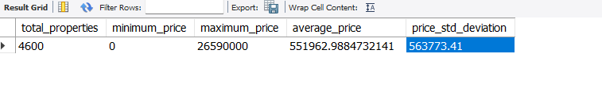
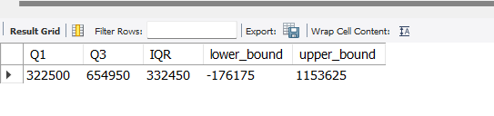
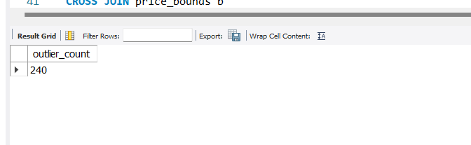
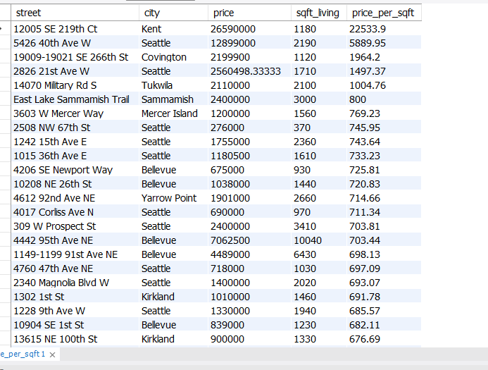
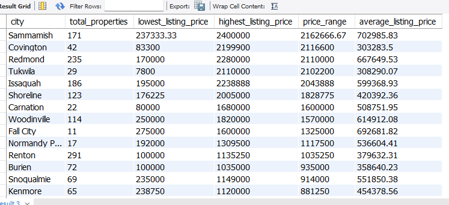
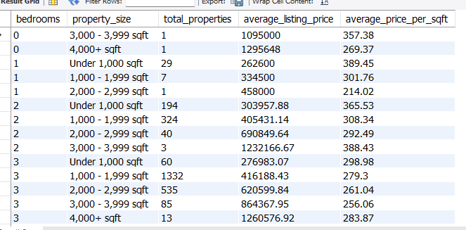
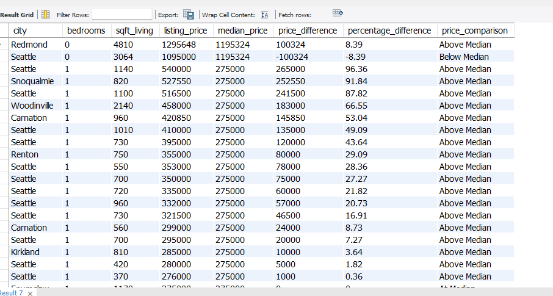
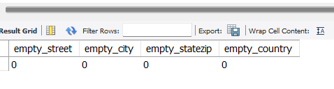
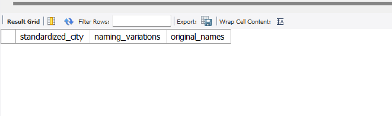

# Real Estate Listings Market Intelligence

An SQL-based analysis of real estate listings examining pricing patterns, location differences, property size, and market comparisons.

**Data source:** [House Data — Kaggle](https://www.kaggle.com/datasets/shree1992/housedata)  
**Repository:** [briannjika-cmyk/real-estate-listings-market-intelligence](https://github.com/briannjika-cmyk/real-estate-listings-market-intelligence)

> **Authorship and interpretation:** GitHub Copilot assisted in writing and editing this README. The inferences, interpretations, conclusions, and recommendations presented here are personal and should be considered alongside the source data and analysis files.

## Project Overview

This project analyzes 4,600 real estate records using SQL. Its queries and exported results cover data completeness, geographic listing counts, price distributions, price per square foot, property-size and bedroom segments, and comparisons with median prices for properties with the same bedroom count.

The repository also contains charts and recommendation documents in the `Recommendations` folder. This README presents recommendations drawn from the findings summarized below; those recommendations are interpretations of the analysis, not additional measured results.

## Findings

### Geographic distribution

The city-count export lists 4,600 properties across 44 cities. Seattle has the largest count, with 1,573 listings, approximately 34.2% of the dataset. The next largest counts are Renton (293), Bellevue (286), Redmond (235), Issaquah (187), Kirkland (187), Kent (185), Auburn (176), Sammamish (175), and Federal Way (148).

This distribution means the overall dataset is weighted toward Seattle listings. A market-wide result should not be assumed to describe every city equally.

### Data completeness

`csv_files/missing_values.csv` reports 4,600 total records and zero missing values for the fields checked, including price, bedrooms, bathrooms, living area, lot size, city, and other listed property attributes. The text-value checks also report no blank street, city, state/ZIP, or country values.

These checks establish that the analyzed fields are populated in the exported result; they do not independently verify whether every recorded value is accurate.

### Price per square foot by city

The neighborhood/city export shows meaningful differences in average price per square foot. Among the higher figures shown are Beaux Arts Village ($500.00), Medina ($492.13), Yarrow Point ($490.38), and Clyde Hill ($429.66). Larger-count examples include Mercer Island ($362.01 across 82 records), Seattle ($326.42 across 1,561 records), Bellevue ($323.75 across 281 records), and Kirkland ($288.28 across 187 records).

The Seattle count in this price-per-square-foot export (1,561) differs from its 1,573 count in `city_count.csv`. The price-per-square-foot calculation filters for valid positive living area, so its included records need not match the city-count total.

Some high city averages are based on very few listings. For example, Beaux Arts Village has one record and Yarrow Point has four in this export. Those values are observations in this dataset, not robust estimates of a whole local market.

### Price by bedroom count and living-area range

The grouped CSV illustrates that total price and price per square foot vary across bedroom and size groups. Selected examples:

| Bedrooms | Living-area range | Listings | Average listing price | Average price per sq ft |
|---:|---|---:|---:|---:|
| 2 | 3,000–3,999 sq ft | 3 | $1,232,166.67 | $388.43 |
| 3 | 4,000+ sq ft | 13 | $1,260,576.92 | $283.87 |
| 4 | 4,000+ sq ft | 102 | $1,308,959.73 | $283.57 |
| 5 | 4,000+ sq ft | 54 | $1,686,474.78 | $312.47 |
| 6 | 4,000+ sq ft | 13 | $1,327,461.54 | $248.80 |
| 8 | 4,000+ sq ft | 1 | $1,970,000.00 | $443.69 |

These examples show why total price and price per square foot should be considered separately. The one-record 8-bedroom group, in particular, should not be generalized to similar homes.

### Extreme price-per-square-foot record

The property-level export includes a striking observation: a Kent listing at 12005 SE 219th Ct is recorded at $26,590,000 with 1,180 square feet of living area, producing $22,533.90 per square foot. This is far above the other examples visible in the export. The data alone cannot establish whether it is an error or a genuinely unusual listing, but it is sufficiently extreme that conclusions relying on averages should be interpreted with care.

## Recommendations Based on the Findings

These are practical market interpretations of the results, not proposed changes to the dataset.

1. **Use city-specific comparisons when evaluating a listing.** Seattle makes up about one-third of the records, so the overall market average is likely to reflect Seattle more than smaller cities. Compare a property with relevant local listings rather than relying on one all-city benchmark.

2. **Consider price per square foot alongside total price.** The grouped results show that a higher total price does not automatically mean a higher price per square foot. Buyers, sellers, and analysts should consider both measures and compare homes with similar size and bedroom counts.

3. **Treat high-price-per-square-foot locations as leads for closer comparison, not automatic valuations.** Medina, Yarrow Point, and Clyde Hill have high averages in the available export, but their small counts limit how confidently those averages can represent a typical property. Review individual comparable listings before drawing a pricing conclusion.

4. **Use adequate comparable groups.** Prefer comparisons supported by several properties with similar location, bedroom count, and living area. A result based on one listing—such as the 8-bedroom, 4,000+ sq ft group—offers little basis for predicting another property's likely price.

5. **Interpret the Seattle and Bellevue results in context.** Their average price per square foot is similar in this export ($326.42 and $323.75 respectively), but this does not establish that individual neighborhoods or property types in the two cities are equivalent. Use more specific comparable properties for decisions.

6. **Review unusually high observations before using averages.** The Kent record at $22,533.90 per square foot could strongly affect an average. For a pricing decision, compare results with and without such an extreme listing and verify the underlying property information where possible.

7. **Use medians and ranges to describe a market, not only averages.** The analysis includes price-boundary and median-comparison queries. In a dataset with an extreme price observation and uneven city counts, median-based comparisons are likely to give a more representative view than a single mean, especially when paired with sample counts.

8. **Treat this analysis as historical listing context, not a current valuation.** The project analyzes a dataset snapshot, not a live feed or a verified appraisal. Confirm current local comparables and property-specific details before making a buying, selling, or investment decision.

## Analysis and Visuals

The SQL queries examine basic statistics, missing and blank values, city-name variations, city counts, IQR-based price boundaries and outliers, price per square foot, and listing prices relative to bedroom-group medians.

The following charts are available in the repository:

### Basic statistics



### Listings by city


### Price boundaries and outliers





### Price per square foot and location





### Bedroom count and property size



### Listing price versus median



### Data checks





## Example Export

A row from `csv_files/price_per_square_ft.csv` demonstrates the property-level calculation:

```csv
street,city,price,sqft_living,price_per_sqft
"12005 SE 219th Ct",Kent,26590000,1180,22533.9
```

This example is included to illustrate an unusually high observation, not to suggest it is a typical Kent listing.

## Repository Materials

- **Raw data:** `data/raw/data.csv`
- **SQL analysis:** `sql/analytics/`
- **CSV results:** `csv_files/`
- **Charts:** `images/`
- **Recommendation documents:** `Recommendations/Patterns.docx`, `Recommendations/SummariesTable.docx`, and `Recommendations/market_intelligence_summary.docx`

## Limitations

- The analysis reflects a static dataset and may not represent current market conditions.
- The dataset is heavily weighted toward Seattle listings.
- Some city and bedroom/size groups have few observations, limiting the strength of conclusions from their averages.
- The extreme Kent observation has not been independently validated.
- Price per square foot is a comparison metric, not a complete valuation method; it does not account for every property characteristic.
- The results describe listing data and should not be treated as an appraisal, forecast, or investment recommendation.

## Conclusion

The results show a Seattle-heavy dataset, complete values in the fields checked, substantial geographic variation in price per square foot, and differences across bedroom and living-area groups. The most defensible use of the results is to guide localized comparisons among similar listings, while considering sample size and treating extreme observations cautiously.

The recommendations in this README are my interpretations of those findings. They are intended as practical guidance for using the reported results, not as claims that the analysis proves a particular property is correctly priced.
